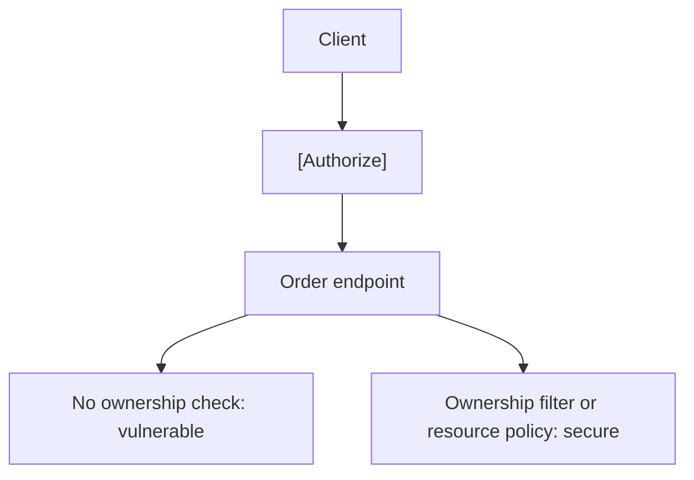

# ASP.NET Core Broken Object-Level Authorization

`[Authorize]` protects the endpoint. Ownership checks protect the data.

Authenticated ≠ authorized for every record.

This is an educational Web API that shows Broken Object-Level Authorization (BOLA), the API form of Insecure Direct Object Reference (IDOR). A signed-in customer can read another customer's order when the action checks authentication and then trusts the route id. The same solution shows the ownership-filtered query and a reusable resource-based rule, including an intentional admin override.

This repository is a security demonstration. It is not a production application and it is not an authentication tutorial.

## What BOLA means

BOLA means the API accepts an identifier for an object and returns or changes that object without proving the caller is allowed to access that specific object. IDOR is the older name for the same mistake when the identifier is a direct object reference, such as `GET /orders/2002`.

Authentication answers "who is this?". Authorization for an object answers "may this person read this order?". `[Authorize]` answers only the first question.

## Why `[Authorize]` is not enough

`[Authorize]` on `GET /api/insecure/orders/{id}` rejects anonymous callers. After that, the action loads the order with `Where(candidate => candidate.Id == id)`. The authenticated user id is available and unused. Order `2002` belongs to User B. User A still receives `200 OK`.

A route id is an object reference. Changing it is not a grant of permission.

## Vulnerable endpoint

`InsecureOrdersController` is labeled demo-only. It returns `OrderDto` and does not select `InternalNotes`.

```csharp
[Authorize]
[HttpGet("{id:int}")]
public async Task<ActionResult<OrderDto>> GetById(int id, CancellationToken cancellationToken)
{
    var order = await _db.Orders
        .AsNoTracking()
        .Where(candidate => candidate.Id == id)
        .SelectDto()
        .FirstOrDefaultAsync(cancellationToken);
    // ...
}
```

User A reads User B's order:

```bash
curl -s -D - -H "X-Demo-User: user-a@example.com" http://127.0.0.1:5080/api/insecure/orders/2002
```

Verified response: `200` and `{"id":2002,"orderNumber":"ORD-2002","status":"Shipped","totalAmount":120.00,"createdAt":"2026-02-02T12:00:00+00:00"}`.

## Secure ownership filter

`GET /api/secure/orders/{id}` reads the caller from `ClaimTypes.NameIdentifier`. It never binds `CustomerUserId` from the query string or body.

```csharp
var order = await _db.Orders
    .AsNoTracking()
    .Where(candidate => candidate.Id == id && candidate.CustomerUserId == userId)
    .SelectDto()
    .FirstOrDefaultAsync(cancellationToken);
```

A missing row and another user's row both return `404` with the same problem body: title `Order not found.` and detail `No order is available for this request.` The response does not reveal whether the other order exists.

`GET /api/secure/my-orders` filters by the same principal id, orders by `Id`, and pages with `page` and `pageSize` (`pageSize` 1–100). A client-supplied owner id is ignored because the action does not accept one.

## Resource-based authorization

`CanReadOrder` is a policy with `ReadOrderRequirement`. The handler receives the loaded `Order`.

```csharp
var userId = context.User.FindFirst(ClaimTypes.NameIdentifier)?.Value;
if (!string.IsNullOrEmpty(userId)
    && string.Equals(userId, resource.CustomerUserId, StringComparison.Ordinal))
{
    context.Succeed(requirement);
    return Task.CompletedTask;
}

if (context.User.IsInRole(AppRoles.Admin))
{
    context.Succeed(requirement);
    return Task.CompletedTask;
}
```

`GET /api/secure/orders/{id}/policy` loads the order and then calls:

```csharp
await _authorization.AuthorizeAsync(User, order, PolicyNames.CanReadOrder);
```

The policy is not placed on `[Authorize]`. An attribute runs before the order exists, so it cannot evaluate ownership. Denial uses the same `404` problem as the filtered query, so the two secure reads do not disagree about whether another user's order exists. Use `403` when the caller is already allowed to know the object exists.

## Admin override

Admin access is explicit. The handler allows `AppRoles.Admin` (`ClaimTypes.Role`) after the owner check fails. That is the privileged override for the policy endpoint.

`GET /api/admin/orders/{id}` is a separate route with `[Authorize(Roles = "Admin")]`. That attribute is a coarse role gate. It runs before the order is loaded, and it is not the resource handler. A customer receives `403` even when the id is missing or invalid, because the role check happens first. An admin receives the order DTO.

## Request flow



## Comparison

| Approach | Authenticated? | Ownership checked? | Safe? |
| --- | --- | --- | --- |
| `[Authorize]` only | Yes | No | No |
| Ownership-filtered query | Yes | Yes | Yes, for the demonstrated read |
| Resource-based authorization | Yes | Yes | Yes, when the handler is invoked with the loaded order |
| Admin override | Yes | Explicit role plus the resource rule | Controlled |

No one of these patterns secures an API by itself. Every read, update, delete, download, and export of a protected object needs the rule that belongs to that operation. More detail is in [docs/security-comparison.md](docs/security-comparison.md).

## Demo authentication

Scheme name: `Demo`. Header: `X-Demo-User`.

The handler is registered only when the environment is `Development` or `Testing` and `DemoAuth:Enabled` is true. The header must be exactly one value. The value must be one of the three seeded emails. The user must exist in the database. The issued claims are `ClaimTypes.NameIdentifier` (the user id), email, display name, and `ClaimTypes.Role`.

Accepted values:

| Caller | Header |
| --- | --- |
| User A | `user-a@example.com` |
| User B | `user-b@example.com` |
| Admin | `admin@example.com` |

`user-a`, `user-b`, `admin`, and any other email are rejected. Sending a user id in the header does not authenticate that user.

Outside Development and Testing, or when `DemoAuth:Enabled` is false, the host registers a handler that never authenticates a caller. Production startup does not enable this scheme.

This is local demo identity. It is not production authentication. Do not expose the header on a shared or internet-facing host.

Swagger is enabled in Development and documents the same header as an API-key security scheme. The description states that the scheme is Development and Testing only.

## Domain and seed data

`AppUser`: `Id`, `Email`, `DisplayName`, `Role`.

`Order`: `Id`, `OrderNumber`, `CustomerUserId`, `Status`, `TotalAmount`, `CreatedAt`, `InternalNotes`.

`CustomerUserId` references `AppUser.Id` with `ON DELETE RESTRICT`. Email and order number are unique. Orders are indexed by `(CustomerUserId, Id)`. `Id` is an explicit integer, not an identity column. `TotalAmount` is `decimal(18,2)`.

| Id | Email | Role |
| --- | --- | --- |
| `user-a` | `user-a@example.com` | Customer |
| `user-b` | `user-b@example.com` | Customer |
| `admin` | `admin@example.com` | Admin |

| Order | Number | Owner | Status | Total | Created (UTC) |
| --- | --- | --- | --- | --- | --- |
| 2001 | ORD-2001 | user-a | Placed | 49.90 | 2026-01-15 12:00 |
| 2002 | ORD-2002 | user-b | Shipped | 120.00 | 2026-02-02 12:00 |
| 2003 | ORD-2003 | user-a | Delivered | 15.25 | 2026-03-10 12:00 |
| 2004 | ORD-2004 | user-b | Placed | 88.40 | 2026-04-04 12:00 |
| 2005 | ORD-2005 | user-a | Cancelled | 10.00 | 2026-05-20 12:00 |

`InternalNotes` contains the marker `SENSITIVE-INTERNAL-NOTE-DO-NOT-LEAK`. `OrderDto` exposes `id`, `orderNumber`, `status`, `totalAmount`, and `createdAt` only.

Seed is an idempotent upsert inside a transaction. Running it again leaves 3 users and 5 orders.

## SQL Server and Docker

The application uses EF Core 10 with the SQL Server provider. The Compose file starts SQL Server 2022 and binds it to `127.0.0.1:1433` only.

```bash
copy .env.example .env
docker compose up -d
```

`.env.example` holds a local-only example SA password. `.env` is gitignored. The named volume is `bola-demo-sql-data`. Do not run `docker compose down -v`; that deletes the volume. Do not point this demo at a shared or production SQL Server.

If port 1433 is already taken, stop only this project's container or change the host port in `docker-compose.yml` and the matching connection settings together. Do not stop unrelated containers.

Connection resolution order:

1. `ConnectionStrings:BolaDemo`
2. `BOLA_DEMO_CONNECTION_STRING`
3. In Development only, `MSSQL_SA_PASSWORD` from the environment or from `.env`, which builds `Server=127.0.0.1,1433;Database=BolaDemo;User Id=sa;...`

`.env` is loaded only in Development, only for `MSSQL_SA_PASSWORD`, `BOLA_DEMO_CONNECTION_STRING`, and `ConnectionStrings__BolaDemo`, and it does not override variables that are already set.

## Migrations and seed

The initial migration is `src/BolaDemo.Api/Data/Migrations/20261119102401_InitialCreate.cs`.

Development startup applies migrations and seed when `Database:InitializeOnStartup` is true (`appsettings.Development.json`). Production and Testing do not migrate on startup. An explicit initialize is refused outside Development and Testing.

```bash
dotnet run --project src/BolaDemo.Api --launch-profile http -- --initialize
```

That command migrates database `BolaDemo` and seeds it, then exits. To update the schema from the EF tool after `dotnet tool restore`:

```bash
dotnet tool restore
dotnet ef database update --project src/BolaDemo.Api
```

`dotnet ef database update` creates the schema and does not seed. Prefer `--initialize` for a runnable demo. The design-time factory uses `BOLA_DEMO_CONNECTION_STRING` when it is set. Its fallback password is the placeholder `Your_local_sa_password` and is not a credential. Generating a migration does not need a live database.

## Run the API

```bash
dotnet run --project src/BolaDemo.Api --launch-profile http
```

The Development profile listens at `http://127.0.0.1:5080`. Swagger UI is `http://127.0.0.1:5080/swagger`. `GET /api/health` is anonymous and returns `{"status":"ok"}`.

Requires the [.NET 10 SDK](https://dotnet.microsoft.com/download) (`global.json` pins `10.0.401` with `latestFeature` roll-forward).

## Run the tests

```bash
dotnet test BolaDemo.slnx -c Release
```

Integration tests use SQL Server. They create a database named `BolaDemoTests_` plus a GUID, migrate, seed, and drop only that database. They do not use EF Core InMemory. They do not drop any other database.

Set one of these before `dotnet test` if `.env` is not in the repo root:

- `MSSQL_SA_PASSWORD` for `sa` on `127.0.0.1,1433`
- `BOLA_DEMO_MASTER_CONNECTION` for an explicit master connection string

If SQL Server cannot be reached, each SQL test is skipped by `SqlFact` and reported as skipped. Skipped tests are not passed tests. Handler, DTO, and host tests still run. The host tests do not open a database.

## Example requests

Anonymous:

```bash
curl -s -o NUL -w "%{http_code}" http://127.0.0.1:5080/api/insecure/orders/2002
```

User A, vulnerable read of User B's order:

```bash
curl -s -H "X-Demo-User: user-a@example.com" http://127.0.0.1:5080/api/insecure/orders/2002
```

User A, secure read of the same order:

```bash
curl -s -H "X-Demo-User: user-a@example.com" http://127.0.0.1:5080/api/secure/orders/2002
```

User A, own order:

```bash
curl -s -H "X-Demo-User: user-a@example.com" http://127.0.0.1:5080/api/secure/orders/2001
```

User B, blocked from User A's order:

```bash
curl -s -H "X-Demo-User: user-b@example.com" http://127.0.0.1:5080/api/secure/orders/2001
```

User A, own orders:

```bash
curl -s -H "X-Demo-User: user-a@example.com" "http://127.0.0.1:5080/api/secure/my-orders?page=1&pageSize=20"
```

Owner through the policy endpoint:

```bash
curl -s -H "X-Demo-User: user-a@example.com" http://127.0.0.1:5080/api/secure/orders/2001/policy
```

Another user through the policy endpoint:

```bash
curl -s -H "X-Demo-User: user-a@example.com" http://127.0.0.1:5080/api/secure/orders/2002/policy
```

Admin through the policy endpoint and the admin route:

```bash
curl -s -H "X-Demo-User: admin@example.com" http://127.0.0.1:5080/api/secure/orders/2002/policy
curl -s -H "X-Demo-User: admin@example.com" http://127.0.0.1:5080/api/admin/orders/2002
```

Customer against the admin route:

```bash
curl -s -o NUL -w "%{http_code}" -H "X-Demo-User: user-a@example.com" http://127.0.0.1:5080/api/admin/orders/2002
```

## Status codes

| Situation | Status |
| --- | --- |
| No `X-Demo-User` header, or a value outside the three emails | 401 |
| `id` less than 1 on a customer order route | 400 |
| Non-numeric id (`abc`) | 404, the route does not match `{id:int}` |
| Order id that does not exist, on a customer route | 404 |
| Ownership mismatch on `GET /api/secure/orders/{id}` | 404 |
| Policy denial for another user's order | 404 |
| Customer calling `GET /api/admin/orders/{id}` | 403 |
| Admin reading an existing order | 200 |
| Owner reading an existing own order | 200 |
| `page` or `pageSize` outside 1–100 | 400 |

## 403 and 404

`404` on the secure customer routes keeps a missing order and a forbidden order indistinguishable. That reduces enumeration when ids are predictable, as `2001` through `2005` are.

`403` tells the caller the object exists and the caller may not have it. That is appropriate for the admin route, where the role decision is made before the lookup, and for cases where the caller already knows the object exists.

Pick one behavior per operation and test it. Mixing `403` and `404` for the same kind of denial leaks information through the difference.

## Common mistakes

- Treating `[Authorize]` as an ownership check.
- Trusting a route, query, or body owner id as the caller.
- Applying a resource policy as an attribute before the resource is loaded.
- Returning the EF entity, which would include `InternalNotes`.
- Returning `403` for some cross-user reads and `404` for others without deciding what that reveals.
- Checking ownership on `GET` and forgetting update, delete, download, and export.
- Caching an authorization decision after ownership can change.
- Letting an admin path skip auditing because the role check succeeded.

## Production recommendations

- Keep the owner-or-admin rule in one handler and call it with the loaded resource.
- Test that rule directly and test each endpoint that depends on it.
- Return DTOs that contain only the fields the caller needs.
- Scope every query to the tenant or owner boundary in the database predicate, then authorize the resource you are about to change.
- Audit sensitive allows and denials, especially admin overrides, without writing secrets into the log.
- Use one status-code policy for a given denial and document it.
- Derive the caller from the authenticated principal.
- Apply the object check to read, update, delete, download, export, and every other operation on that object.
- Re-check authorization when ownership or state can change between the check and the write.
- Keep admin access least-privilege, separate from customer routes, and auditable.

A filtered query, a resource handler, or an admin role does not make the rest of the API safe. Each new endpoint has to enforce the rule that matches its operation.

## Known limitations and verification

Verified on 19 November 2026 on this machine.

| Check | Result |
| --- | --- |
| `dotnet --info` | SDK `10.0.401`, host `10.0.12`, ASP.NET Core `10.0.12` |
| `dotnet restore` | Not completed. `https://api.nuget.org/v3/index.json` timed out (`curl` exit 28). |
| `dotnet build BolaDemo.slnx -c Release --no-restore` | Succeeded. 0 warnings, 0 errors. Packages came from the local NuGet cache. |
| `dotnet test ... -c Release --no-restore` | 31 passed, 0 failed, 0 skipped. |
| SQL integration tests | 17 passed, 0 failed, 0 skipped, 0 not run. |
| Handler, DTO, and host tests | 14 passed. These do not replace the SQL tests. |
| `docker compose config` | Valid. |
| SQL Server | `16.0.4305.5` Developer Edition (SQL Server 2022), container `bola-demo-sqlserver`, port `127.0.0.1:1433`. |
| Database | `BolaDemo`. Migration `20261119102401_InitialCreate`. Users `3`. Orders `5`. |
| API smoke tests | See the table below. The API was then stopped. |

Smoke results against `http://127.0.0.1:5080`:

| Request | Status |
| --- | --- |
| `GET /api/health` | 200 |
| Anonymous `GET /api/insecure/orders/2002` | 401 |
| User A `GET /api/insecure/orders/2002` | 200, body is ORD-2002, no internal notes |
| User A `GET /api/secure/orders/2002` | 404 |
| User A `GET /api/secure/orders/2001` | 200, ORD-2001 |
| User B `GET /api/secure/orders/2001` | 404 |
| User A `GET /api/secure/orders/2001/policy` | 200 |
| User A `GET /api/secure/orders/2002/policy` | 404 |
| Admin `GET /api/secure/orders/2002/policy` | 200, ORD-2002 |
| User A `GET /api/admin/orders/2002` | 403 |
| Admin `GET /api/admin/orders/2002` | 200 |
| User A `GET /api/secure/my-orders` | 200, orders 2001, 2003, 2005 |
| User B `GET /api/secure/my-orders` | 200, orders 2002, 2004 |
| User A `GET /api/secure/orders/9999` | 404 |
| User A `GET /api/secure/orders/0` | 400 |
| Header `user-b` on the insecure route | 401 |

Test databases prefixed `BolaDemoTests_` were dropped. No other database was dropped. `docker compose down -v` was not run.

`dotnet restore` and a build that restores from the network were not completed because NuGet.org timed out. A clean checkout needs network access to `api.nuget.org` before `dotnet build` or `dotnet test` can restore packages. The committed project files use EF Core `10.0.12`, `Microsoft.Data.SqlClient` `6.1.6`, Swashbuckle `10.3.1`, xUnit `2.9.3`, and the test SDK `17.14.1`.

The local `dotnet-ef` manifest is version `10.0.12`. `dotnet tool restore` also needs NuGet.org. The migration checked in here was generated with the installed global `dotnet-ef` `10.0.12`.

Git was not initialized. Nothing was committed or pushed.

## Project layout

```text
src/BolaDemo.Api/                 Web API, EF Core model, migration, demo auth
tests/BolaDemo.Api.Tests/         Handler tests, host tests, SQL Server integration tests
docs/security-comparison.md       Side-by-side authorization comparison
docker-compose.yml                SQL Server 2022 on 127.0.0.1:1433
.env.example                      Local SA password example
```

## License

MIT. Copyright (c) 2026 BolaDemo contributors.
