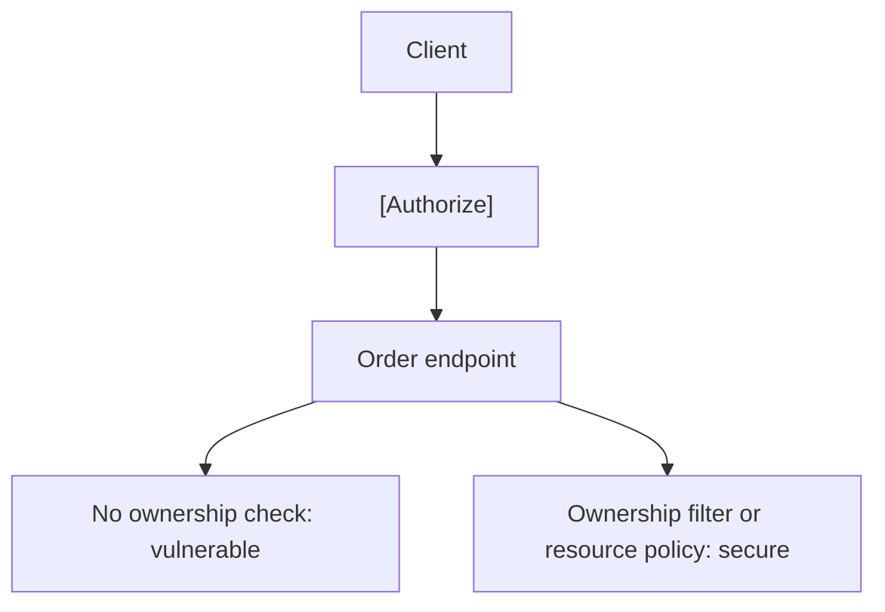

# Security comparison

`[Authorize]` protects the endpoint. Ownership checks protect the data.

Authenticated ≠ authorized for every record.

This note compares the four reads in the demo. All of them require an authenticated demo user unless the table says otherwise. All of them return `OrderDto`. None of them return `InternalNotes`.

## Flow

Anonymous callers stop at `[Authorize]` with `401`. They never reach the ownership decision.

## Comparison

| Approach | Route | Authenticated? | Ownership checked? | Safe? |
| --- | --- | --- | --- | --- |
| `[Authorize]` only | `GET /api/insecure/orders/{id}` | Yes | No | No |
| Ownership-filtered query | `GET /api/secure/orders/{id}` and `GET /api/secure/my-orders` | Yes | Yes, in the query | Yes, for the demonstrated read |
| Resource-based authorization | `GET /api/secure/orders/{id}/policy` | Yes | Yes, handler receives the `Order` | Yes, when `AuthorizeAsync` is called with that order |
| Admin override | Policy handler, plus `GET /api/admin/orders/{id}` | Yes | Explicit `Admin` role, and the resource rule on the policy route | Controlled |

## What each route does

### Vulnerable read

The filter is `candidate.Id == id`. User A calling `/api/insecure/orders/2002` receives User B's order with `200`. The action logs a warning that names the caller and the order id. The DTO still omits internal notes, which shows that a safe response shape does not fix a missing ownership check.

### Filtered read

The filter is `candidate.Id == id && candidate.CustomerUserId == userId`. `userId` comes from `ClaimTypes.NameIdentifier`. The same call returns `404` and the problem title `Order not found.` User A calling `/api/secure/orders/2001` returns ORD-2001.

`/api/secure/my-orders` uses `CustomerUserId == userId`, `OrderBy(Id)`, and skip/take. Query keys such as `customerUserId` are not parameters of the action, so they cannot change the set.

### Policy read

The action loads the order by id, then calls `IAuthorizationService.AuthorizeAsync(User, order, "CanReadOrder")`. The handler allows the owner, then allows a principal in the `Admin` role, and otherwise fails closed. A failed result is mapped to the same `404` problem as the filtered read.

`[Authorize(Policy = "CanReadOrder")]` is intentionally absent. The policy needs the order instance. An attribute would run before that instance exists.

### Admin route

`[Authorize(Roles = "Admin")]` runs before the action. A customer receives `403` for `/api/admin/orders/2002`, for a missing id, and for `id` `0`. An admin receives the DTO. This route does not call `ReadOrderAuthorizationHandler`. The role gate is the whole decision, and the comments in `AdminOrdersController` say so.

## 403 versus 404

| Choice | What the caller learns | Where this demo uses it |
| --- | --- | --- |
| `404` for both missing and forbidden | The response does not confirm that another user's order exists | Secure by-id read and policy denial |
| `403` | The caller is authenticated and is not allowed; the resource check happened as a role gate | Admin route for every non-admin |

`404` is the better customer-facing choice here because order ids are sequential and easy to guess. `403` is the better choice when existence is already known, or when the denial is a role decision that happens before a lookup. The two secure customer reads use the same problem body so a client cannot tell them apart by status or title.

`400` is reserved for an id below 1 and for paging values outside 1–100. A non-numeric segment does not match `{id:int}` and the framework returns `404`.

## Proof the tests lock in

The SQL Server integration tests assert both sides of the bug:

- `Vulnerable_endpoint_lets_User_A_read_User_B_order_2002` expects `200` and ORD-2002, and checks the database row is owned by `user-b`.
- `Secure_endpoint_blocks_User_A_from_reading_User_B_order_2002` expects `404` and a body that does not contain `ORD-2002`.
- Policy tests expect `200` for the owner, `404` for the other customer, and `200` for admin on both users' orders.
- The admin route expects `200` for admin and `403` for a customer.
- My-orders expects only the caller's ids, including when the request adds a foreign owner id.
- DTO JSON property names are `createdAt`, `id`, `orderNumber`, `status`, and `totalAmount`.

Handler unit tests cover owner success, admin success on another user's order, customer denial, a `CustomerUserId` claim without `NameIdentifier`, a short `role` claim that ASP.NET Core does not treat as a role, and an unauthenticated principal. Those tests do not open SQL Server.

## What still has to be true in a real API

- The same object rule has to run for update, delete, download, and export, not only for these GET actions.
- If ownership can change after the check, the write has to check again.
- Admin success should be audited.
- Multi-tenant data needs the tenant boundary in the query, in addition to the user id.
- Demo header authentication must be replaced before any shared deployment.

Passing this demo's tests means these routes behave as specified against SQL Server. It does not mean a different endpoint is safe.
